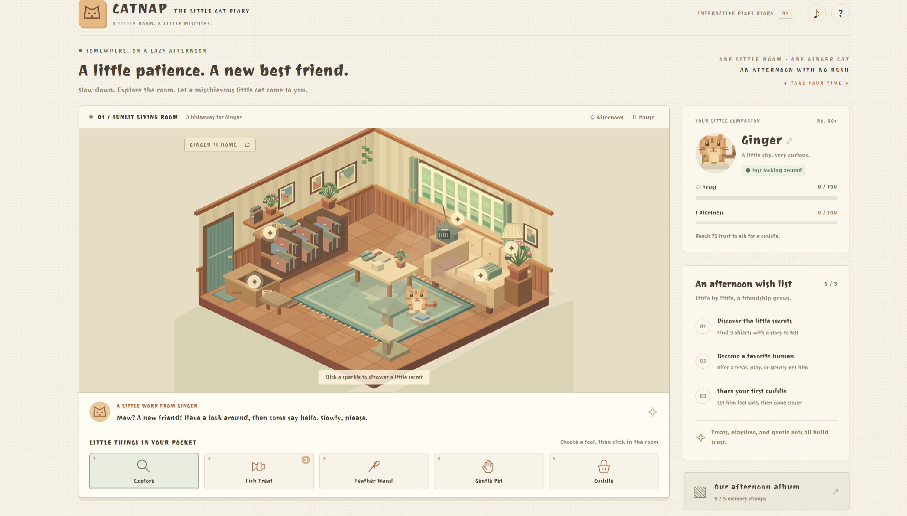

# CATNAP — Catch the Mischievous Cat

**Author:** YIN Shiqi  

**Course:** SD5913 · Assignment 3: An interactive experience  

CATNAP is a small, relaxed game about making friends with a shy ginger cat. Explore a sunlit room, offer a treat, play with a feather, and earn enough trust for a cuddle. There is no countdown: the challenge is to notice how the cat responds and choose a gentler next action.



## Idea and intended user

The experience is intended for casual desktop players who want a short, playful break. It uses familiar actions—clicking, moving the pointer, and holding still—rather than fast reflexes or complicated controls. This is the intended audience, not a claim based on a large user study.

The starting prototype let the player offer food and catch the cat while it ate. After a friend found the interaction repetitive and the scene too simple, I expanded the interaction around **building trust**. The revised goal is to persuade the cat to accept a cuddle, rather than simply click it at the right moment. See [PROCESS.md](PROCESS.md) for the trial, changes, and AI disclosure.

## Play online

**[Play CATNAP in your browser](https://yinsylvie.github.io/Catnap/)**

The English game is hosted publicly on GitHub Pages. No login or local server is needed.

## Run locally

Keep the project files together. From a fresh terminal, change into the folder containing `index.html`, then run:

```sh
python --version
python -m http.server 8000 --bind 127.0.0.1
```

Open **[http://127.0.0.1:8000/](http://127.0.0.1:8000/)** in a modern desktop browser. This address is only for the local-server option; use the public link above to play online. Stop the local server with Ctrl+C. 

Python 3 is used only as a convenient static web server. There are **no Python packages, npm packages, build steps, API keys, accounts, or external game services** to install or configure. A Python requirements file is therefore not needed. The game itself uses HTML, CSS, and browser JavaScript. It needs Canvas 2D and Pointer Events; optional sound uses Web Audio, and memory stamps use browser storage.

You can also open `index.html` directly. A consistent local web address is recommended because browser storage behavior for local files varies. If you do not have Python installed, direct opening lets you play without installing anything.

**Repository:** [YINSylvie/Catnap](https://github.com/YINSylvie/Catnap). The configured repository returned HTTP 200 to an anonymous request on 25 October 2026. The latest changes still need to be committed and pushed. No live game link has been verified for this edition.

## How to play

Choose a tool in the bottom tray, then use it in the room. The message below the room explains the response and the next action.

| Player input | Program response | Feedback and next action |
| --- | --- | --- |
| **Explore:** click a sparkling object | Records a first discovery and adds 5 trust | Shows its story, a check mark, particles, and the updated trust meter. Find three objects to complete the exploration task. |
| **Fish Treat:** click clear floor or rug | Places one treat; Ginger walks around furniture and eats it | The treat, walking/eating animation, and progress bar show what is happening. Finishing adds 25 trust. There are three treats per round. |
| **Feather Wand:** move over clear floor, then click near Ginger | Invites him to approach and pounce | A jump, particles, and a message confirm the pounce. Each successful pounce adds 12 trust; allow a short break before the next one. |
| **Gentle Pet:** press and hold on a settled cat for 1.8 seconds | Accumulates petting progress when alertness is at most 30 | The heart/progress indicator fills; completion adds 18 trust. Wait three seconds before another pet. Releasing early cancels the attempt. |
| **Cuddle:** click Ginger with at least 75 trust and alertness below 30 | Completes the experience, provided he is not eating | A celebration, result summary, memory stamp, and another-round button appear. |
| Move the mouse suddenly near the cat or ask for a cuddle too early | Raises alertness; high alertness can make him hide | The meter, message, and hiding cue explain the change. Wait, find the correct hiding place, or offer a treat. |

The three wish-list tasks track exploration, a successful friendly interaction, and a cuddle. They guide play; completing all three is not a prerequisite for the cuddle ending. Five album stamps record discoveries and friendly milestones.

### Controls, reset, and interruptions

- **Mouse:** select tools, click objects/floor/the cat, and press and hold to pet.
- **Keyboard:** **1–5** select tools; **arrow keys** move the floor cursor; **Enter** uses a tool; hold Enter to pet. **Space** pauses/resumes; **Esc** closes a dialog. Tab can focus objects and the cat.
- **Start Over** resets the current round, food supply, trust, alertness, discoveries, and interactions. Earned album stamps stay in the current browser.
- **Pause/Resume** stops and restarts play. Leaving the tab automatically pauses the game. Help and album dialogs suspend game updates while open.
- The afternoon/evening button changes the lighting. The sound button enables short interaction tones; sound starts off, and every important response also has visual/text feedback.

### An ordinary mistake and recovery

Trying to leave a treat on furniture is rejected with a message and does not use a treat. Repeated discoveries do not award extra trust, only one treat can be placed at a time, and repeated pounces/pets have short waiting periods. Clicking the wrong hiding place does not teleport the cat there. An interrupted pet is cancelled rather than silently awarding a reward.

## Files and dependencies

```text
index.html             Page and accessible controls
styles.css             Desktop layout and visual styling
assets/fonts/          Joti One font and SIL Open Font License
script.js              Game state, drawing, navigation, input, and synthesized tones
docs/screenshot.png    Screenshot of the English desktop game
tests/game-check.cjs   Optional checks using Node.js built-in modules
README.md              Idea, controls, setup, and limitations
PROCESS.md             Development, user trial, decisions, and verification
CREDITS.md             Code, visual references, audio, fonts, and AI attribution
```

The room, cat, and effects are drawn in code; no downloaded image files are needed for play. The supplied background track is bundled in `assets/audio/`. Joti One is bundled locally in `assets/fonts/`, alongside its SIL Open Font License, so the font does not require an external font service. The screenshot is documentation only. The source has no third-party JavaScript libraries. See [CREDITS.md](CREDITS.md) for the scope of that statement and visual-reference acknowledgements.

## Verification and limitations

The interaction was checked through automated state tests and browser play. The browser route **three discoveries → one finished treat → three pounces → cuddle** reached the ending at 76 trust. A held keyboard interaction also completed petting. English messages, help, desktop layout, and the browser error log were checked after translation.

Optional developer checks, if Node.js is installed:

```sh
node --check script.js
node tests/game-check.cjs
```

These checks use Node.js built-in modules only. The state tests use a mocked page/canvas and do not replace browser testing or the human trial.

- The main target is a desktop browser with a mouse or keyboard. Real phone hardware and all browser/assistive-technology combinations have not been tested.
- Canvas is a visual play surface. Labels and focusable controls support keyboard use, but a fully equivalent nonvisual experience has not been established.
- Album stamps are stored only in the current browser. Clearing site data or using restricted/private storage may lose them; play continues without successful saving.
- Optional tones can depend on browser audio support and user activation. Background music is optional; there is no spoken narration or required audio input.
- Navigation uses a small grid with fixed furniture obstacles. It is a lightweight game rule, not a realistic simulation of animal behavior.
- The recorded trial involved one friend and the early prototype. A further independent trial of the final version would provide stronger evidence of usability.

## Typography

The game uses Joti One by Eduardo Tunni for the interface and Canvas text cues. The unmodified font file and SIL Open Font License 1.1 are included in `assets/fonts/`. The font is served from the same location as the game; no Google Fonts network request is required during play. See `CREDITS.md` for the source.

## Background music — 31 October 2026

- **Track:** Kitten’s Sunny Room (approximately 2:20).
- **Creator shown on Suno:** YINnuomi929; generated/shared through Suno.(AI music I’ve created on Suno)
- **Source supplied by the project author:** [Suno sharing link](https://suno.com/s/yovTrfOexonOwGfT).
- **Song page:** [Kitten’s Sunny Room](https://suno.com/song/4f2e0a62-c4ef-4311-8feb-8b1dd72a9ba8).
- **Local file:** `assets/audio/bgm.mp3`. The supplied recording is stored without audio editing; the game loops it at 60% volume. No open-source licence or public-domain status is asserted for the track.

Music and synthesized interaction tones share the top-right sound button. They start off; click the button to enable them. Music pauses when sound is off, the game is paused, or the page is hidden. If playback fails, a message explains the problem and the game remains playable. The file is served with the game rather than requiring a Suno login during play. The full Pages package must include `assets/audio/`.
